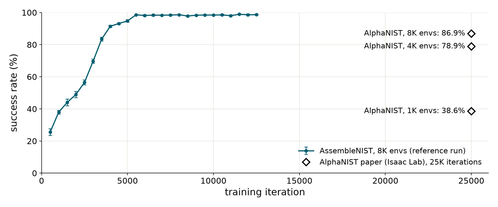
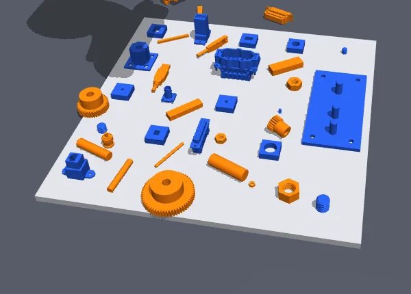
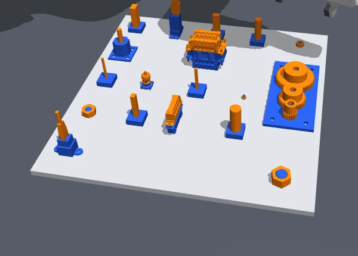

AssembleNIST is an independent, open-source implementation of [AlphaNIST](https://alpha-nist.github.io/) in [MuJoCo](https://mujoco.org/). A single reinforcement-learning policy, trained with PPO from binary success rewards, controls a Franka Panda arm and completes all 20 assembly tasks on the NIST Assembly Task Board 1. Code, pretrained policies, and instructions are in the [GitHub repository](https://github.com/suniique/assembly-nist). This project is not affiliated with or endorsed by the AlphaNIST authors.

## Results

With 8,192 parallel environments, the policy reaches 98.4% success after 10K PPO iterations and 98.7% after 12.5K. AlphaNIST reports 86.9% after 25K iterations, but it uses a different simulator, asset set, and implementation, so the numbers are not directly comparable.

Left: the 20 parts at random initial poses. Right: the board after assembly.

## Acknowledgements

This project builds on [AlphaNIST](https://alpha-nist.github.io/) and [Success Guided Sampling](https://sgs-rl.github.io/). Thanks to [Octi Zhang](https://zoctipus.github.io) for guidance on training details and [Jing Zhang](https://jingz6676.github.io/) for helpful discussions.
